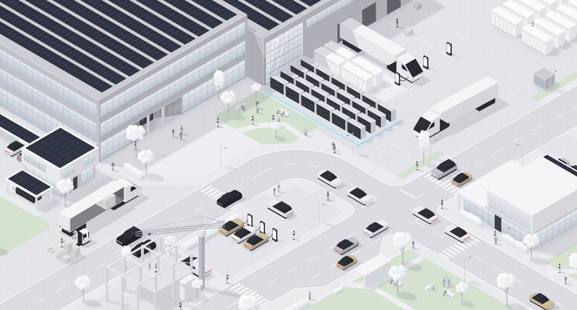

# live-factory

A self-running isometric factory town for React, in a soft white-clay style. Semis back into the docks, robotaxis
swap passengers, cars charge and humanoid robots walk around. No text and nothing to configure: drop it in and it
plays.

<p align="center">
  <a href="https://albsramos.github.io/live-factory/">
    <picture>
      <source media="(prefers-color-scheme: dark)" srcset="docs/demo-dark.gif">
      
    </picture>
  </a>
</p>

<p align="center">
  <a href="https://albsramos.github.io/live-factory/"><b>Live demo</b></a> ·
  <a href="#quick-start">Quick start</a> ·
  <a href="#props">Props</a> ·
  <a href="#dark-mode">Dark mode</a>
</p>

## Quick start

**1. Install it.** It isn't on npm yet, so install it straight from GitHub. React 17 or newer is the only
requirement.

```sh
npm install github:albsramos/live-factory
```

**2. Render it.**

```tsx
import { LivingCity } from 'live-factory';

export function Hero() {
  return <LivingCity style={{ borderRadius: 24 }} />;
}
```

That's it. It fills the width of its container at the scene's own shape, follows your site's light or dark mode, and
pauses while it's scrolled out of view. It works the same in Vite, Next.js (it's already marked `'use client'`) or
any other React setup.

## What's in the scene

- **Traffic**: cars, SUVs, an angular pickup, two-seat robotaxis and a robovan drive a small road network. They stop
  at an invisible signal at the junction, give way to people already on the zebra crossings, and hold back while a
  truck pulls out. Semis only come for the yard and the loading bay, so there are never more than two at once.
- **Truck yard**: one semi at a time turns in off the avenue. It drives down the yard lane past its dock, then backs
  in with the trailer swinging round. It loads under a green dock lamp, then pulls out across the yard and turns
  onto the avenue once there's a gap. People on the pavement wait at the yard's gate and exit while a semi crosses,
  well clear of where its trailer swings, and the same goes for the charging lot's driveways.
- **Loading bay**: a semi pulls into the bay beside the factory and rolls up its curtain side. A forklift and two
  humanoid robots fill it pallet by pallet, then it closes up and drives off across the scene.
- **Robots**: humanoid robots, white-shelled with a black glass head, black waist, hands and feet, carry boxes
  between the docked trailers, help load the semi at the bay, patrol the battery yard, work on the construction slab
  and make up about half of the walkers on the streets.
- **AI compute**: a wide platform of 24 server-rack blocks along the dock wing, reaching out into the truck yard as
  far as the semis' turning room allows, with blinking status lights and a pulsing cyan glow along its base. Above
  it, a tall glass atrium in the dock wing glows warm at night.
- **Parks for the staff**: a pocket park on the corner by the plaza and a bigger one east of the pavilion, with grass,
  paths, trees and benches where employees sit or stand together on their break.
- **Charging**: cars nose into the chargers, charge (with a pulsing light and cable), back out and leave.
- **Robotaxi stop**: pods and the van pull into the bay, open their doors, let people off, pick people up and go.
- **Construction**: a tower crane swings between the material pile and the slab while workers move around.
- **The home beside the loading bay**: solar roof, wall batteries with breathing status lights, and a carport where
  the car is on its charger.
- **The outskirts**, for wide views: a new factory wing and a long staff car park under solar canopies to the west
  (a few cars come and go on its service road), and to the east a second compute platform, a Megapack field with a
  robot doing its rounds, and a charging hub that cars turn into off the avenue.
- **Day and night**: by day the glazing is a faded blue-grey glass; at night it glows warm and lights the ground in
  front of the buildings, headlights throw beams along the road ahead of each car, and tail lights glow red, brighter
  when a car brakes or waits.
- **Ambient detail**: walkers on a walkway network (they come and go beyond the edges of the view, or through a
  door), people chatting, a dog on a walk, trees swaying and pulsing battery status lights.

There is a light theme and a night theme, and by default the scene matches the page it sits on (see
[Dark mode](#dark-mode)). Everything is drawn on one `<canvas>`, and the only dependency is React.

## Sizing

By default the component is as wide as its container and keeps the scene's own aspect ratio (about 1.86 : 1). Give
it a height, or put it in a sized box, and it fills that instead:

```tsx
<div style={{ height: '70vh' }}>
  <LivingCity style={{ height: '100%' }} density={0.8} />
</div>
```

- `fit="cover"` (the default) fills the box. In a box taller than the scene it crops the sides; in a wider one it
  shows more of the outskirts instead of cropping the middle away, down to 70 % of the scene's height.
- `fit="contain"` always shows the whole height. Beyond the classic frame the town keeps going (a factory wing, a
  staff car park, a second compute platform, Megapacks, a charging hub, a staff park), so a wide banner is filled
  edge to edge rather than letterboxed:

```tsx
<LivingCity fit="contain" style={{ height: 520 }} /> {/* a 1630 × 520 hero, say */}
```

## Props

| Prop | Default | |
|---|---|---|
| `theme` | `'auto'` | `'auto'` matches the page around it (see *Dark mode*). `'light'` or `'dark'` (night) fixes one look |
| `speed` | `1` | Simulation speed. `0.5` is calm, `2` is busy |
| `density` | `1` | How many people and cars, from `0.3` to `1.5` |
| `seed` | `7` | Changes who walks where and which cars appear |
| `fit` | `'cover'` | `'cover'` fills the box (see *Sizing*). `'contain'` shows the whole height, outskirts filling the sides |
| `focus` | `[0.5, 0.5]` | When `cover` crops, which part stays in view (`[0, 0]` is top left) |
| `zoom` | `1` | Extra zoom on top of the fit |
| `isPaused` | `false` | Freeze on the current frame |
| `maxDpr` | `2` | Cap on the device pixel ratio. Lower it to trade sharpness for speed |
| `isReducedMotionIgnored` | `false` | Keep moving even when the visitor has asked for reduced motion (by default the scene then holds still) |
| `label` | none | Accessible description. Without it the scene is treated as decorative (`aria-hidden`) |
| `className`, `style` | none | Applied to the wrapper `div` |

In 0.2.0 `paused` became `isPaused` and `respectReducedMotion` became `isReducedMotionIgnored` (inverted: leave it
out to keep respecting the setting).

## Dark mode

With `theme="auto"` (the default) the scene takes the theme of the page around it, checking these in order:

1. A `data-theme` attribute on the nearest ancestor that has one, set to `"dark"` or `"light"`. Bootstrap's
   `data-bs-theme`, `data-color-scheme`, `data-mode` and `data-mantine-color-scheme` count too.
2. A `dark` or `light` class on `<html>` or `<body>`, which is what Tailwind's class strategy and next-themes set.
3. The visitor's system setting (`prefers-color-scheme`).

It watches those attributes, classes and the system setting, so a theme toggle on your site switches the scene as
well. The outgoing frame dissolves into the new one over about half a second. Before the first frame, the box shows
the theme's ground colour, so it doesn't flash white in a dark layout.

The same logic is exported as `resolveTheme(element)` and `watchTheme(element, onChange)` if you drive the engine
yourself.

## Behaviour worth knowing

- The animation stops while the component is scrolled out of view, and when the tab is hidden.
- Static scenery is rendered once per size into cached bitmaps, so a frame mostly stamps images and draws the
  moving parts. Resizing re-renders those caches.
- On mount, the scene runs about 40 simulated seconds in the background, so the first frame is already busy rather
  than empty.
- It is safe for server rendering: nothing touches `window` or `document` until it mounts.

## Without React

The engine is framework-free:

```ts
import { Scene } from 'live-factory';

const scene = new Scene(canvas, { theme: 'dark', density: 0.8 });
scene.resize(canvas.clientWidth, canvas.clientHeight); // CSS pixels; call again when the size changes
// scene.set({ paused: true }) · scene.setVisible(false) · scene.destroy()
```

## Other ways to install

- **From GitHub** (the quick start): `npm install github:albsramos/live-factory`. npm clones the repository and builds
  `dist/` on install (the `prepare` script). pnpm and Yarn take the same `github:` spec; pnpm may ask you to approve
  that build step. Add `#<tag or commit>` to pin a version.
- **As a tarball:** `npm run build && npm pack`, then `npm install live-factory-0.2.0.tgz` in your app.
- **Inside your own component library:** copy `src/` into it. It is plain TypeScript and React with no other imports.
- **Publish it:** run `npm publish` (or rename it first, for example `@your-scope/live-factory`). The build produces
  ESM, CommonJS and type declarations in `dist/`.

## Develop

```sh
npm install
npm run dev                # the demo website (site/), with theme, shape, speed and crowd controls
npm run dev:lab            # the dev lab: ?gallery shows every vehicle, ?debug exposes window.scene
npm run build              # library build into dist/
npm run typecheck
npm run check:components   # the demo site's components against the react-component rules
npm run check:sim          # 20 simulated minutes: nobody run over, no collisions, traffic flowing
npm run record:gifs        # re-record the README previews (needs Playwright and ffmpeg)
npm run build:site         # site-dist/: the demo website
npm run build:artifact     # artifact-dist/live-factory.html: the same page as one file
```

Every push to `main` rebuilds the demo website and publishes it to GitHub Pages (`.github/workflows/pages.yml`).
`AGENTS.md` and `docs/` explain the codebase for people and coding agents alike.

### How it works

- `engine/core.ts`: projection (true isometric: X = (x − y)·cos 30°, Y = (x + y)/2 − z) and matte materials that
  shade each face from one key light.
- `engine/sort.ts`: painter's order. Every drawable has a world bounding box. Pairs that overlap on screen are
  ordered by the axis that separates them, and a depth-first walk gives the draw order.
- `engine/vehicles.ts`: small convex meshes, and a traffic model. Lanes are filleted paths. A semi's trailer
  follows its tractor with a hitch model going forward. When reversing, it replays a recorded forward pull-out
  backwards, which keeps the swing physically right. Each vehicle brakes for anything on the stretch of road it
  is about to drive. Junctions and crosswalks are zones it reserves in advance: first come, first served, with an
  actuated signal at the junction. Only the front vehicle of a queue reserves, and a semi reserves everything within
  a truck length at once, so it never waits with its trailer across a lane.
- `engine/walkers.ts`: people and robots, with a walk cycle and a walkway graph to wander.
- `engine/activities.ts`: the scripted scenes (truck yard, loading bay, charging lot, robotaxi stop, crane, dog
  walk); `engine/stalls.ts`: car parks whose cars come and go.
- `engine/world.ts`: the layout: ground plan, buildings, props, routes and walkways; `engine/outskirts.ts`: what lies
  beyond the classic frame, for wide views.
- `engine/lights.ts`: headlight beams, tail lights and lamp glints at night.
- `engine/scene.ts`: camera fit, the cached ground layer with baked soft shadows, bitmap caching and the frame loop.

The scene uses no logos, wordmarks or text.
